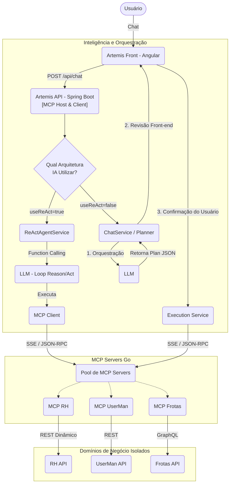

# Arquitetura e Funcionamento do Sistema Artemis

Este documento é a base estruturada para a compreensão da arquitetura do projeto. Ele detalha os fluxos de Inteligência Artificial, os papéis do Model Context Protocol (MCP), a integração com múltiplos domínios e as abordagens de execução do orquestrador principal.

## 1. Visão Geral da Arquitetura

O **Artemis** é um ecossistema projetado com forte isolamento de responsabilidades, combinando Inteligência Artificial (suportando modelos locais para privacidade e modelos na nuvem para raciocínio avançado) com um padrão de integração moderno, o **Model Context Protocol (MCP)**. A arquitetura permite a expansão modular para múltiplos domínios de negócio de maneira plug-and-play.

Os componentes principais são organizados nos seguintes papéis:

### MCP Host & Client (Cérebro e Orquestração)
1. **Artemis Front (Angular 18):** Interface com o usuário, de onde partem as requisições de chat, aprovações de planos (HITL) e visualização de resultados.
2. **Artemis API (Spring Boot + Spring AI):** O "Cérebro" orquestrador da plataforma.
   - **Roteamento de IA (`LlmRouterService`)**: Alterna de forma transparente entre LLMs Locais (Ollama) e LLMs em Nuvem (OpenAI/DeepSeek) baseando-se na solicitação do cliente.
   - **Gerenciador de Abordagens**: Implementa dois padrões arquiteturais de agentes distintos — **ReAct** (Autônomo) e **Plan-and-Execute** (Supervisionado).
   - **MCP Host/Client**: Descobre e se conecta dinamicamente aos diversos servidores MCP (via protocolo SSE) e provê essas ferramentas para a IA.

### MCP Servers & APIs de Domínio
A plataforma é desenhada para suportar múltiplos domínios isolados. Cada domínio possui seu próprio **MCP Server (Go)** e **Domain API (Java)**:

* **Domínios Atuais (Já Desenvolvidos):**
  1. **Módulo RH:**
     - **Artemis MCP RH (Go):** Expõe as ferramentas de Recursos Humanos para o cérebro.
     - **Artemis RH API (Spring Boot):** Microsserviço de domínio com filtros dinâmicos via `Specification`.
     - **PostgreSQL (postgres-rh):** Banco de dados isolado.
  2. **Módulo UserMan (Gestão de Usuários):**
     - **Artemis MCP UserMan (Go):** Expõe ferramentas de busca de perfis e bloqueio de acessos.
     - **Artemis UserMan API (Spring Boot):** Microsserviço focado na gestão de acessos e roles.
     - **PostgreSQL (postgres-userman):** Banco de dados isolado.
  3. **Módulo Frotas:**
     - **Artemis MCP Frotas (Go):** Adapta ferramentas para integração via queries e mutations GraphQL.
     - **Artemis Frotas API (Spring Boot):** Microsserviço construído com **Spring GraphQL**.

* **Novos Domínios (Pipeline de Evolução):** Formulários e SGIE (Sistema de Eleições).

---

## 2. Diagrama de Fluxo de Comunicação (Multi-Domínio)

---

## 3. Passo a Passo: As Duas Arquiteturas de Execução IA

O **Artemis API** é capaz de atuar sob dois paradigmas distintos, selecionados a partir do Front-end.

### Abordagem A: Plan-and-Execute (Modo Orquestrador / HITL)
Padrão focado em segurança, estabilidade e **supervisão humana** (Human-in-the-Loop).
1. **Entrada e Planejamento (`PlannerService`)**: O sistema utiliza o LLM apenas para ler a intenção e gerar um "Plano de Ação" (JSON) dividindo o pedido em Domínios e Ações (ex: Domínio RH). Nenhuma ferramenta técnica é chamada ainda.
2. **Resolução de Entidades e Especialistas (`EntityResolverService` & `SpecialistService`)**: Regras de código nativas mapeiam nomes genéricos para IDs de banco de dados e validam se todos os parâmetros obrigatórios foram fornecidos. Se algo estiver ambíguo (ex: Dois usuários com o mesmo nome), o sistema recua e pede clarificação ao usuário.
3. **Revisão Humana (Frontend)**: Uma "Proposta de Plano" é devolvida para a tela do usuário. O sistema pausa aguardando o clique no botão "Confirmar".
4. **Execução (`ExecutionService`)**: Após o consentimento, o client MCP dispara de forma bruta (JSON-RPC via SSE) o comando final para o MCP Server de destino.
5. **Síntese e Retorno (`FinalSummarizerService`)**: Os dados brutos das APIs são reunidos e repassados para um LLM final apenas para redigir o retorno em texto amigável.

### Abordagem B: ReAct (Modo Autônomo)
Padrão focado em **agilidade e autonomia do agente**.
1. **Tool Calling Nativo (`ReActAgentService`)**: O LLM recebe a requisição do usuário, um prompt de sistema rigoroso e a lista de **todas as ferramentas MCP disponíveis** daquele momento.
2. **Loop de Raciocínio (Reason & Act)**: Diferente do Planner, a IA deduz os parâmetros, chama as ferramentas (via *Spring AI Tools* que engatilha o MCP Client internamente) de forma autônoma. Se ela falhar ou precisar de mais dados, ela própria chama outra ferramenta ou pede dados extras ao usuário, em um loop contínuo.
3. **Retorno Direto**: Assim que conclui sua lógica, responde imediatamente ao usuário, sem as fases de pausa ou aprovação estruturada na tela.

---

## 4. Regras e Princípios Chave

* **Clareza nos Papéis MCP:** A arquitetura divide responsabilidades: a API Artemis dita o ritmo (Host) e se conecta aos provedores de recursos (Servers MCP).
* **Flexibilidade de IA:** O isolamento da camada de inferência permite transitar entre Ollama local e LLMs externos (OpenAI) dependendo da restrição de sigilo do dado (Local) ou necessidade de cognição apurada (Cloud).
* **Escalabilidade Multi-Domínio (Plug and Play):** Novos domínios podem ser inseridos acionando apenas um novo servidor MCP em Go. O Host lê a nova lista de ferramentas ao vivo e já se torna capaz de orquestrar aquele novo ecossistema.
* **Prevenção de "Endpoint Sprawl" (Filtros Dinâmicos):** Para evitar a explosão de múltiplos endpoints nas Domain APIs, adota-se o padrão REST dinâmico com **Spring Data Specifications**. Os MCP Servers encapsulam a chamada e passam os filtros na query string, otimizando processamento.
* **Isolamento de Dados:** Cada módulo de domínio obedece estritamente ao padrão de microsserviços possuindo sua própria base de dados relacional.
